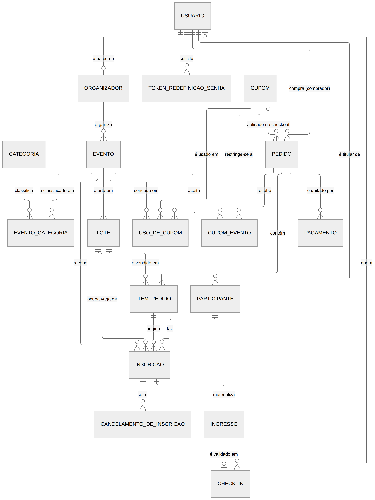

# Sistema de Gestão de Eventos, Ingressos e Participantes (Ducktix)

Disciplina: Banco de Dados II — UDESC
Equipe: Bruno Werner

**Vídeo de demonstração:** <https://youtu.be/fovdRduLR8Y>
**Repositório (público):** <https://github.com/uBrunoow/ducktix>

> **Fase 1** — banco relacional PostgreSQL · **Fase 2** — banco NoSQL MongoDB.
>
> Na Fase 2 o PostgreSQL foi **substituído** pelo MongoDB, e a aplicação passou
> a operar só sobre ele. As seções 1 a 4 descrevem o domínio e o modelo
> relacional da Fase 1 — a base da modelagem —; a
> [seção 9](#9-fase-2--banco-nosql-mongodb) mostra como cada parte ficou no
> MongoDB: collections, documentos, restrições e os mesmos relatórios
> reescritos como agregações. Os arquivos do PostgreSQL (DDL, migrations e
> backup) estão preservados em `ducktix/database/legacy-postgres/`.

## Onde está cada item da entrega

**Fase 2 — repositório**

| Exigência | Onde |
|---|---|
| (a) Código-fonte da aplicação (operando sobre o MongoDB) | `ducktix/src/` — repositórios em `ducktix/src/server/*/infrastructure/mongo-*.ts` |
| (b) Scripts de criação do banco de dados | `ducktix/database/criar-banco.js` (collections, validação e índices) e `ducktix/database/scripts/seed.mjs` (dados iniciais) — ver [9.7](#97-scripts-de-criação-e-dados) |
| (c) Instruções de compilação e execução | `README.md` (raiz do repositório) — resumidas na seção [6](#6-instruções-de-compilação-e-execução) |

**Fase 1 — item 1, documento de texto**

| Exigência | Seção |
|---|---|
| (a) Introdução explicativa do domínio de informação | [1](#1-introdução-ao-domínio-de-informação) |
| (b) Esquema conceitual | [2](#2-esquema-conceitual) |
| (c) Esquema lógico na forma de dicionário de dados | [3](#3-esquema-lógico-relacional--dicionário-de-dados) |
| Link do repositório | [7](#7-repositório-do-projeto) |

**Fase 1 — item 2, repositório**

| Exigência | Onde |
|---|---|
| (a) Código-fonte da aplicação | `ducktix/src/` |
| (b) Backup do banco de dados | `ducktix/database/legacy-postgres/backup.sql` |
| (c) Instruções de compilação e execução | `README.md` (raiz do repositório) — resumidas na seção [6](#6-instruções-de-compilação-e-execução) |

**Requisitos da aplicação**

| Exigência | Seção | Situação |
|---|---|---|
| CRUD de todas as tabelas de entidade | [4.2](#42-crud-das-tabelas-de-entidade) | parcial — ver [8.2](#82-pendente) |
| Processo de negócio para todas as tabelas associativas | [4.3](#43-processos-de-negócio-das-tabelas-associativas) | 6 de 6 |
| Mínimo de 3 relatórios com associação de mais de uma tabela | [4.4](#44-relatórios-do-sistema) | 3 de 3 |
| Banco com dados previamente inseridos | [5](#5-banco-de-dados) | ✅ |
| Interface final não pode ser REST | [4.1](#41-interface-final) | ✅ interface gráfica |

---

## 1. Introdução ao Domínio de Informação

O domínio escolhido é a **gestão de eventos, ingressos e participantes** — um
sistema equivalente, em complexidade, a plataformas comerciais de venda de
ingressos e inscrições (ex.: Sympla, Eventbrite). O projeto, batizado
**Ducktix**, cobre o ciclo completo de vida de um evento: criação, publicação,
comercialização de ingressos, inscrição de participantes, emissão de ingressos,
check-in no dia do evento e tratamento de cancelamentos.

O domínio foi deliberadamente explorado além do trio trivial
"Evento – Participante – Ingresso", incorporando os seguintes aspectos do mundo
real:

- **Organizadores**: especialização de usuário responsável por criar e publicar
  eventos. Um organizador mantém múltiplos eventos ao longo do tempo.
- **Local do evento**: endereço em texto livre no próprio evento —
  obrigatório para eventos presenciais e híbridos, proibido para eventos 100%
  online (restrição garantida no banco).
- **Categorias**: taxonomia reutilizável (música, tecnologia, esporte…)
  associada a eventos em relação **muitos-para-muitos**: o modelo permite que
  um evento pertença a mais de uma categoria (a tela de criação usa uma).
- **Modalidade e ciclo de publicação**: um evento é presencial, online ou
  híbrido, transita por estados (rascunho, publicado, encerrado, cancelado) e
  tem visibilidade própria (público ou não listado) — o que impacta a venda e a
  aparição na vitrine.
- **Lotes de ingresso**: a venda não tem preço único fixo — o evento é dividido
  em lotes (1º lote, 2º lote, Pista, Meia), cada um com preço, vagas, prazo de
  encerramento e contador de vendas controlados.
- **Pedidos e itens de pedido**: o participante realiza um pedido que pode
  conter múltiplos itens (lotes diferentes, quantidades diferentes), refletindo
  o comportamento real de um carrinho. Carrinho e compra são a mesma entidade em
  estados distintos, com **reserva temporária de 30 minutos** das vagas.
- **Pagamentos**: entidade própria, com método (cartão, Pix, boleto), status
  (pendente, aprovado, recusado, estornado) e valor — desacoplando a etapa
  financeira da emissão dos ingressos e permitindo mais de uma tentativa.
- **Cupons de desconto**: com tipo (percentual ou fixo), janela de validade,
  limite de uso e **restrição opcional a eventos específicos**. Cada aplicação
  é registrada individualmente, com o desconto rateado por evento.
- **Participantes**: quem ocupa a vaga **não precisa ter conta**. Uma pessoa
  pode comprar 3 ingressos nominais a 3 amigos diferentes, e cada um deles
  existe como participante próprio.
- **Inscrições**: o vínculo participante × evento, criado na confirmação do
  pedido — uma inscrição por unidade comprada. É a tabela central dos
  relatórios de ocupação, presença e receita.
- **Ingressos**: cada inscrição materializa um ingresso com código único, que
  vira o QR apresentado na entrada.
- **Check-in**: controle de entrada, vinculado a um ingresso específico e ao
  usuário que operou a portaria. No máximo um por ingresso.
- **Cancelamentos**: fluxo de pós-venda — o participante solicita o
  cancelamento de uma inscrição, com motivo, e o organizador aprova ou nega;
  ficam registradas as datas de solicitação e resolução.

Regras de negócio que o modelo sustenta: um evento publicado precisa de
informações mínimas; a quantidade vendida de um lote nunca ultrapassa as vagas
(concorrência de venda resolvida com travamento de linha na Fase 1 e com
update condicional atômico na Fase 2); o preço pago é
histórico e não muda se o lote for reajustado; um ingresso só é emitido após a
confirmação do pedido; e presença é um fato datado, distinto de estar inscrito
— quem não comparece é o *no-show*, que o relatório precisa evidenciar.

---

## 2. Esquema Conceitual

### 2.1 Diagrama Entidade-Relacionamento



Notação pé-de-galinha: `||` exatamente um, `o|` zero ou um, `|{` um ou mais,
`o{` zero ou mais. Fonte editável do diagrama:
`ducktix/docs/diagramas/modelo-conceitual.mmd` (Mermaid); versão vetorial em
`modelo-conceitual.svg`.

### 2.2 Entidades e atributos principais

| Entidade | Atributos principais |
|---|---|
| **USUARIO** | nome, e-mail (único), senha (hash), papel, CPF/CNPJ, foto, criado em |
| **ORGANIZADOR** | nome fantasia, documento, e-mail de contato |
| **PARTICIPANTE** | nome, sobrenome, e-mail, CPF, celular, nome no crachá, LinkedIn, GitHub, empresa, segmento, cargo, nível |
| **CATEGORIA** | nome (único), slug |
| **EVENTO** | slug, nome, descrição, local, modalidade, formato online, status, visibilidade, início, término, imagem, destaque na vitrine |
| **LOTE** | nome, preço, vagas, vendidos, início e fim da venda, ordem |
| **PEDIDO** | status, criado em, reservado até, confirmado em, CPF e endereço de cobrança; enquanto aberto: cupom aplicado e rascunho dos participantes |
| **ITEM_PEDIDO** | quantidade, preço unitário congelado |
| **PAGAMENTO** | método, status, valor, código externo, pago em |
| **CUPOM** | código (único dentro de cada evento), tipo, valor, validade, limite, usos, ativo |
| **USO_DE_CUPOM** | desconto concedido, usado em |
| **INSCRICAO** | preço pago, status, como conheceu, inscrito em |
| **INGRESSO** | código (único), status, emitido em |
| **CHECK_IN** | realizado em, operador |
| **CANCELAMENTO** | motivo, status, solicitado em, resolvido em |

### 2.3 Cardinalidades e participação

| Relacionamento | Cardinalidade | Participação |
|---|---|---|
| USUARIO — ORGANIZADOR | 1 : 0..1 | Um usuário tem no máximo um perfil de organizador |
| USUARIO — PARTICIPANTE | 1 : N | Participante pode não ter conta (ingresso nominal a terceiro) |
| USUARIO — PEDIDO | 1 : N | Todo pedido tem um comprador com conta |
| ORGANIZADOR — EVENTO | 1 : N | Evento obrigatoriamente tem organizador |
| EVENTO — CATEGORIA | N : N | Via `EVENTO_CATEGORIA` |
| EVENTO — LOTE | 1 : N | O assistente de criação exige o primeiro lote |
| PEDIDO — ITEM_PEDIDO | 1 : N | Pedido confirmado tem ao menos um item |
| LOTE — ITEM_PEDIDO | 1 : N | Item aponta exatamente um lote |
| PEDIDO — PAGAMENTO | 1 : N | Pedido aberto pode ter zero pagamentos |
| CUPOM — PEDIDO | 0..1 : N | Cupom aplicado durante o checkout (opcional) |
| CUPOM — EVENTO | N : N | Via `CUPOM_EVENTO` (restrição da campanha) |
| CUPOM — PEDIDO — EVENTO | ternário | Via `USO_DE_CUPOM`, registrado na confirmação |
| ITEM_PEDIDO — INSCRICAO | 1 : N | Uma inscrição por unidade comprada |
| PARTICIPANTE — INSCRICAO | 1 : N | Quem ocupa a vaga |
| INSCRICAO — INGRESSO | 1 : 1 | Toda inscrição materializa um ingresso |
| INGRESSO — CHECK_IN | 1 : 0..1 | No máximo um check-in por ingresso |
| USUARIO — CHECK_IN | 0..1 : N | Operador da portaria (nulo se a conta for removida) |
| INSCRICAO — CANCELAMENTO | 1 : N | Inscrição pode não ter nenhuma solicitação |

### 2.4 Observações de modelagem

1. **Participante não é usuário.** São entidades separadas porque o comprador
   (sempre um `USUARIO`) pode emitir ingressos nominais a terceiros sem conta
   no sistema. Quando o participante tem conta, `participante.usuario_id` a
   referencia.
2. **Carrinho não é entidade própria.** É o `PEDIDO` com status `aberto` —
   modelar um "carrinho" separado duplicaria itens e preços.
3. **Inscrição é a associativa central.** Ela liga participante, evento, item de
   pedido e lote, e é dela que saem os três relatórios.
4. **Cupom é criado dentro de um evento.** Na aplicação, o organizador cria o
   cupom a partir da página do evento, o que gera a linha em `CUPOM_EVENTO`. O
   mesmo código pode existir em eventos diferentes, mas não duas vezes no mesmo
   evento, e o checkout só aceita o cupom no evento vinculado.
5. **Relações 1:1 viram colunas, não tabelas.** Dados de cobrança pertencem ao
   pedido e dados profissionais pertencem ao participante: em ambos os casos a
   cardinalidade é 1:1 e o dado nunca é lido sem a entidade dona, então uma
   tabela à parte só acrescentaria um JOIN sem ganho de integridade.
6. **Não há cadastro de locais.** O endereço do evento é texto livre na própria
   tabela `evento` — a plataforma não reutiliza locais entre eventos.
7. **Estado transitório do carrinho fica no pedido.** Enquanto o pedido está
   `aberto`, `pedido.cupom_id` guarda o cupom digitado e
   `pedido.participantes_rascunho` guarda o formulário de participantes ainda
   não enviado. O fato definitivo só é gravado na confirmação (`USO_DE_CUPOM`,
   `PARTICIPANTE`, `INSCRICAO`).

---

## 3. Esquema Lógico Relacional — Dicionário de Dados

**SGBD (Fase 1):** PostgreSQL 16. **DDL executável:** `ducktix/database/legacy-postgres/schema.sql`.

Convenções: tabelas no singular em `snake_case`; PK `id` do tipo `UUID` com
`gen_random_uuid()`; valores monetários em **centavos** (`INTEGER`), nunca
ponto flutuante; datas em `TIMESTAMPTZ`; toda FK indexada.

Legenda: `PK` chave primária · `FK` chave estrangeira · `UK` única ·
`NN` não nulo · `CK` verificação · `DF` padrão.

### 3.1 `usuario`

| Coluna | Tipo | Restrições | Descrição |
|---|---|---|---|
| id | UUID | PK, DF gen_random_uuid() | Identificador |
| nome | VARCHAR(120) | NN | Nome de exibição |
| email | VARCHAR(160) | NN, UK | Login e contato |
| senha_hash | VARCHAR(255) | NN | Hash da senha |
| papel | VARCHAR(20) | NN, CK ∈ {participante, organizador} | Área de acesso |
| cpf_cnpj | VARCHAR(14) | NULL, CK length ∈ {11,14} | Só dígitos |
| foto_url | TEXT | NULL | Foto de perfil |
| criado_em | TIMESTAMPTZ | NN, DF now() | Cadastro |

### 3.2 `organizador`

| Coluna | Tipo | Restrições | Descrição |
|---|---|---|---|
| id | UUID | PK | Identificador |
| usuario_id | UUID | FK → usuario CASCADE, NULL, UK | Conta dona do perfil; um usuário = no máx. um organizador. Nulo para organizadores só de exibição (dados de demonstração) |
| nome_fantasia | VARCHAR(140) | NN | Nome na vitrine |
| documento | VARCHAR(14) | NULL | CNPJ/CPF |
| email_contato | VARCHAR(160) | NULL | Contato público |

### 3.3 `participante`

| Coluna | Tipo | Restrições | Descrição |
|---|---|---|---|
| id | UUID | PK | Identificador |
| usuario_id | UUID | FK → usuario SET NULL, NULL | Nulo quando não tem conta |
| nome | VARCHAR(80) | NN | Nome |
| sobrenome | VARCHAR(80) | NN | Sobrenome |
| email | VARCHAR(160) | NN | Contato |
| cpf | VARCHAR(11) | NULL | Só dígitos |
| celular | VARCHAR(20) | NULL | Telefone |
| nome_cracha | VARCHAR(80) | NULL | Nome no crachá |
| linkedin / github | VARCHAR(200) | NULL | Perfis profissionais |
| empresa | VARCHAR(140) | NULL | Onde trabalha |
| segmento / cargo | VARCHAR(80) | NULL | Segmento e cargo |
| nivel | VARCHAR(40) | NULL | Experiência |

### 3.4 `token_redefinicao_senha`

| Coluna | Tipo | Restrições | Descrição |
|---|---|---|---|
| token | VARCHAR(120) | PK | Token enviado |
| usuario_id | UUID | FK → usuario CASCADE, NN | Dono |
| expira_em | TIMESTAMPTZ | NN | Validade |

### 3.5 `categoria`

| Coluna | Tipo | Restrições | Descrição |
|---|---|---|---|
| id | UUID | PK | Identificador |
| nome | VARCHAR(60) | NN, UK | Nome exibido |
| slug | VARCHAR(60) | NN, UK | Identificador de URL |

### 3.6 `evento`

| Coluna | Tipo | Restrições | Descrição |
|---|---|---|---|
| id | UUID | PK | Identificador |
| organizador_id | UUID | FK → organizador, NN | Responsável |
| slug | VARCHAR(160) | NN, UK | URL pública; não muda ao renomear |
| nome | VARCHAR(140) | NN | Título |
| descricao | TEXT | NN | HTML sanitizado |
| local | VARCHAR(160) | NULL | Endereço em texto livre; nulo se online |
| modalidade | VARCHAR(12) | NN, CK ∈ {presencial, online, hibrido} | Como acontece |
| formato_online | VARCHAR(20) | NULL, CK ∈ {ao-vivo, videoconferencia, desafio-virtual, conteudo-digital} | Só online/híbrido |
| status | VARCHAR(12) | NN, DF 'rascunho', CK ∈ {rascunho, publicado, encerrado, cancelado} | Publicação |
| visibilidade | VARCHAR(12) | NN, DF 'publico', CK ∈ {publico, nao-listado} | Listagem |
| comeca_em | TIMESTAMPTZ | NN | Início |
| termina_em | TIMESTAMPTZ | NN, CK > comeca_em | Término |
| imagem_url | TEXT | NULL | Banner |
| is_highlighted | BOOLEAN | NN, DF false | Destaque na vitrine |
| criado_em | TIMESTAMPTZ | NN, DF now() | Criação |

**CK compostas:** `modalidade='online'` ⇔ `local IS NULL` (online não tem
local; presencial e híbrido exigem); `modalidade='presencial'` ⇔
`formato_online IS NULL` (online e híbrido precisam dizer como a parte online
acontece).

### 3.7 `evento_categoria` *(associativa)*

| Coluna | Tipo | Restrições | Descrição |
|---|---|---|---|
| evento_id | UUID | PK, FK → evento CASCADE | Evento |
| categoria_id | UUID | PK, FK → categoria CASCADE | Categoria |

**Processo de negócio:** classificar evento.

### 3.8 `lote`

| Coluna | Tipo | Restrições | Descrição |
|---|---|---|---|
| id | UUID | PK | Identificador |
| evento_id | UUID | FK → evento CASCADE, NN | Evento dono |
| nome | VARCHAR(60) | NN | "Lote 1", "Pista" |
| preco_centavos | INTEGER | NN, CK ≥ 0 | 0 = gratuito |
| vagas | INTEGER | NN, CK > 0 | Ofertadas |
| vendidos | INTEGER | NN, DF 0, CK ≥ 0 | Contador |
| inicia_em | TIMESTAMPTZ | NULL | Abertura da venda; nulo = desde a publicação |
| encerra_em | TIMESTAMPTZ | NULL | Fechamento da venda; nulo = até o evento começar |
| ordem | SMALLINT | NN, DF 0 | Exibição |
| — | — | **CK vendidos ≤ vagas** | Invariante da venda |
| — | — | CK encerra_em > inicia_em (quando ambos preenchidos) | Janela de venda coerente |
| — | — | UK (evento_id, nome) | Nome único no evento |

### 3.9 `pedido`

| Coluna | Tipo | Restrições | Descrição |
|---|---|---|---|
| id | UUID | PK | Identificador |
| comprador_id | UUID | FK → usuario, NN | Quem paga |
| status | VARCHAR(12) | NN, DF 'aberto', CK ∈ {aberto, confirmado, cancelado} | Estado |
| criado_em | TIMESTAMPTZ | NN, DF now() | Criação |
| reservado_ate | TIMESTAMPTZ | NULL | Reserva de 30 min |
| confirmado_em | TIMESTAMPTZ | NULL | Confirmação |
| cobranca_cpf | VARCHAR(11) | NULL | CPF do comprador |
| cobranca_cep | VARCHAR(8) | NULL | Só dígitos |
| cobranca_logradouro | VARCHAR(160) | NULL | Rua |
| cobranca_numero / _complemento | VARCHAR(20) / (80) | NULL | Endereço |
| cobranca_bairro | VARCHAR(80) | NULL | Bairro |
| cobranca_cidade | VARCHAR(80) | NULL | Cidade |
| cobranca_uf | CHAR(2) | NULL | UF |
| cupom_id | UUID | FK → cupom, NULL | Cupom aplicado enquanto o pedido está aberto |
| participantes_rascunho | JSONB | NULL | Rascunho do formulário de participantes (só com o pedido aberto) |
| — | — | CK cobrança: se `status='confirmado'`, CPF, CEP, logradouro, cidade e UF vêm todos preenchidos ou todos nulos | Pedido gratuito não tem cobrança; pedido pago tem cobrança completa |

### 3.10 `item_pedido` *(associativa)*

| Coluna | Tipo | Restrições | Descrição |
|---|---|---|---|
| id | UUID | PK | Identificador |
| pedido_id | UUID | FK → pedido CASCADE, NN | Pedido |
| lote_id | UUID | FK → lote, NN | Lote comprado |
| quantidade | INTEGER | NN, CK > 0 | Unidades |
| preco_unitario_centavos | INTEGER | NN, CK ≥ 0 | **Preço congelado** |
| — | — | UK (pedido_id, lote_id) | Não duplica lote |

**Processo de negócio:** adicionar ao carrinho.

### 3.11 `pagamento`

| Coluna | Tipo | Restrições | Descrição |
|---|---|---|---|
| id | UUID | PK | Identificador |
| pedido_id | UUID | FK → pedido CASCADE, NN | Pedido |
| metodo | VARCHAR(10) | NN, CK ∈ {cartao, pix, boleto} | Instrumento |
| status | VARCHAR(12) | NN, DF 'pendente', CK ∈ {pendente, aprovado, recusado, estornado} | Estado |
| valor_centavos | INTEGER | NN, CK ≥ 0 | Valor cobrado |
| codigo_externo | VARCHAR(200) | NULL | Pix / linha digitável |
| criado_em | TIMESTAMPTZ | NN, DF now() | Geração |
| pago_em | TIMESTAMPTZ | NULL | Compensação |

### 3.12 `cupom`

| Coluna | Tipo | Restrições | Descrição |
|---|---|---|---|
| id | UUID | PK | Identificador |
| codigo | VARCHAR(24) | NN | Código digitado no checkout. Único dentro de cada evento — regra validada pela aplicação ao criar o cupom, pois o evento fica em `cupom_evento` |
| tipo_desconto | VARCHAR(12) | NN, CK ∈ {percentual, fixo} | Natureza |
| valor | INTEGER | NN, CK > 0 | 1–100 (%) ou centavos |
| valido_de | TIMESTAMPTZ | NN | Início |
| valido_ate | TIMESTAMPTZ | NN, CK > valido_de | Fim |
| limite_uso | INTEGER | NN, CK > 0 | Teto |
| usos | INTEGER | NN, DF 0, CK usos ≤ limite_uso | Contador |
| ativo | BOOLEAN | NN, DF true | Desativação manual |
| criado_em | TIMESTAMPTZ | NN, DF now() | Criação |
| — | — | CK percentual ⇒ valor ≤ 100 | Não passa de 100% |

### 3.13 `cupom_evento` *(associativa)*

| Coluna | Tipo | Restrições | Descrição |
|---|---|---|---|
| cupom_id | UUID | PK, FK → cupom CASCADE | Cupom |
| evento_id | UUID | PK, FK → evento CASCADE | Evento em que vale |

**Processo de negócio:** restringir a campanha por vínculo explícito em
`cupom_evento`. O mesmo código pode existir em eventos diferentes.

### 3.14 `uso_de_cupom` *(associativa)*

| Coluna | Tipo | Restrições | Descrição |
|---|---|---|---|
| id | UUID | PK | Identificador |
| cupom_id | UUID | FK → cupom, NN | Cupom |
| pedido_id | UUID | FK → pedido CASCADE, NN | Pedido |
| evento_id | UUID | FK → evento, NN | Evento do rateio |
| desconto_centavos | INTEGER | NN, CK ≥ 0 | Concedido |
| usado_em | TIMESTAMPTZ | NN, DF now() | Momento |
| — | — | UK (cupom_id, pedido_id, evento_id) | Uma linha por trio |

**Processo de negócio:** aplicar cupom, com desconto rateado por evento.

### 3.15 `inscricao` *(associativa)*

| Coluna | Tipo | Restrições | Descrição |
|---|---|---|---|
| id | UUID | PK | Identificador |
| evento_id | UUID | FK → evento, NN | Evento |
| participante_id | UUID | FK → participante, NN | Quem ocupa a vaga |
| item_pedido_id | UUID | FK → item_pedido CASCADE, NN | Item que originou |
| lote_id | UUID | FK → lote, NN | Lote comprado |
| preco_pago_centavos | INTEGER | NN, CK ≥ 0 | Valor da vaga |
| status | VARCHAR(12) | NN, DF 'ativa', CK ∈ {ativa, cancelada} | Estado |
| como_conheceu | VARCHAR(120) | NULL | Origem declarada |
| inscrito_em | TIMESTAMPTZ | NN, DF now() | Data |
| — | — | UK (evento_id, participante_id, item_pedido_id) | Sem duplicata |

**Processo de negócio:** emitir ingresso / inscrever participante.

### 3.16 `ingresso`

| Coluna | Tipo | Restrições | Descrição |
|---|---|---|---|
| id | UUID | PK | Identificador |
| inscricao_id | UUID | FK → inscricao CASCADE, NN, UK | 1:1 |
| codigo | VARCHAR(64) | NN, UK | Conteúdo do QR |
| status | VARCHAR(12) | NN, DF 'emitido', CK ∈ {emitido, utilizado, cancelado} | Estado |
| emitido_em | TIMESTAMPTZ | NN, DF now() | Emissão |

### 3.17 `check_in` *(associativa)*

| Coluna | Tipo | Restrições | Descrição |
|---|---|---|---|
| id | UUID | PK | Identificador |
| ingresso_id | UUID | FK → ingresso CASCADE, NN, UK | Ingresso validado |
| operador_id | UUID | FK → usuario SET NULL, NULL | Quem operou a portaria |
| realizado_em | TIMESTAMPTZ | NN, DF now() | Entrada |

**Processo de negócio:** realizar check-in. O `UNIQUE` garante uma entrada por ingresso.

### 3.18 `cancelamento_de_inscricao`

| Coluna | Tipo | Restrições | Descrição |
|---|---|---|---|
| id | UUID | PK | Identificador |
| inscricao_id | UUID | FK → inscricao CASCADE, NN | Inscrição |
| motivo | VARCHAR(200) | NULL | Justificativa |
| status | VARCHAR(12) | NN, DF 'solicitado', CK ∈ {solicitado, aprovado, negado} | Trâmite |
| solicitado_em | TIMESTAMPTZ | NN, DF now() | Abertura |
| resolvido_em | TIMESTAMPTZ | NULL | Fechamento |

### 3.19 Entidades vs. associativas

| Tipo | Tabelas |
|---|---|
| **Entidade** (CRUD — ver situação em 4.2) | `usuario`, `organizador`, `participante`, `token_redefinicao_senha`, `categoria`, `evento`, `lote`, `pedido`, `pagamento`, `cupom`, `ingresso`, `cancelamento_de_inscricao` |
| **Associativa** (processo de negócio) | `evento_categoria`, `item_pedido`, `cupom_evento`, `uso_de_cupom`, `inscricao`, `check_in` |

### 3.20 Normalização

O esquema está na **3ª Forma Normal**:

- **1FN** — atributos atômicos: endereço de cobrança decomposto em colunas;
  lotes em tabela própria (não lista dentro do evento); categorias via
  associativa (não coluna multivalorada). A única exceção é
  `pedido.participantes_rascunho` (JSONB), justificada abaixo.
- **2FN** — sem dependência parcial: as associativas de chave composta
  (`evento_categoria`, `cupom_evento`) só contêm as chaves; as demais usam chave
  substituta com `UNIQUE` declarado à parte.
- **3FN** — sem dependência transitiva: `evento` guarda `organizador_id` e as
  categorias por FK, não os nomes; `inscricao` não repete dados do participante.
  Relações 1:1 (cobrança no pedido, dados profissionais no participante) são
  colunas da própria entidade: dependem só da chave, sem transitividade.

**Denormalizações deliberadas**, cada uma justificada:

| Coluna | Motivo |
|---|---|
| `lote.vendidos` | Contador materializado — é a linha travada (`SELECT … FOR UPDATE`) na transação de venda. Recalcular por `COUNT` a cada leitura de vitrine seria caro. |
| `cupom.usos` | Idem: o teto é verificado a cada aplicação. |
| `item_pedido.preco_unitario_centavos` | **Não é redundância** — é fato temporal. Reajuste do lote não altera pedido antigo. |
| `inscricao.lote_id`, `inscricao.preco_pago_centavos` | Alcançáveis via `item_pedido`, mas presentes para evitar dois JOINs em tabela de milhões de linhas nos relatórios. |
| `pedido.participantes_rascunho` (JSONB) | Não é dado do domínio: é o formulário do checkout salvo enquanto o pedido está aberto. Na confirmação vira linhas em `participante` e `inscricao`, que são normalizadas. |
| `pedido.cupom_id` | Cupom digitado e ainda não usado. O registro definitivo do uso é `uso_de_cupom`, gravado só na confirmação. |

### 3.21 Índices

`idx_evento_status_comeca`, `idx_evento_highlighted`, `idx_evento_organizador`,
`idx_lote_evento`, `idx_pedido_comprador`, `idx_item_pedido_pedido`,
`idx_item_pedido_lote`, `idx_pagamento_pedido`, `idx_inscricao_evento`,
`idx_inscricao_participante`, `idx_inscricao_lote`, `idx_ingresso_codigo`,
`idx_check_in_ingresso`, `idx_uso_cupom_cupom`, `idx_uso_cupom_evento`,
`idx_evento_categoria_cat`.

---

## 4. A Aplicação

### 4.1 Interface final

A interface final é uma **aplicação web com interface gráfica**, construída em
Next.js (App Router) + TypeScript. As operações de escrita são executadas por
**Server Actions** — funções que rodam no servidor e são invocadas diretamente
pelos formulários da interface.

> [!important] Sobre a exigência "REST não será aceito como interface final"
> O sistema **não expõe uma API REST como interface final**. A interface é a
> própria aplicação gráfica, e a camada de aplicação
> (`src/server/*/application/`) é chamada diretamente pelas Server Actions. A
> rota HTTP existente em `src/app/api/uploads` é apenas um adaptador auxiliar
> para upload de arquivos.

A arquitetura em camadas isola o domínio da infraestrutura:

```
domain/            regras de negócio puras (sem SQL, HTTP ou React)
application/       casos de uso — orquestram domínio + ports
ports/             interfaces de repositório
infrastructure/    implementações concretas
```

Foi essa separação que tornou a Fase 2 (NoSQL) uma troca de
`infrastructure/`: os repositórios Drizzle/PostgreSQL deram lugar a
repositórios MongoDB que implementam as mesmas interfaces, e domínio, casos de
uso e telas não mudaram (seção [9](#9-fase-2--banco-nosql-mongodb)).

### 4.2 CRUD das tabelas de entidade

O enunciado define CRUD como **cadastro, consulta, atualização e remoção**. A
matriz abaixo declara a situação de cada uma das 12 tabelas de entidade.

| # | Tabela | C | R | U | D | Onde na aplicação |
|---|---|:--:|:--:|:--:|:--:|---|
| 1 | `usuario` | ✅ | ✅ | ✅ | ⬜ | `/register`, `/login`, `/account` (perfil, foto e senha) |
| 2 | `evento` | ✅ | ✅ | ✅ | ✅ | `/organizer/events/new`, `/organizer/events`, `/organizer/events/{id}/edit` (editar, publicar, despublicar, cancelar e excluir) |
| 3 | `lote` | ✅ | ✅ | ✅ | ✅ | `/organizer/events/{id}/lotes` — editar e excluir só sem vendas |
| 4 | `cupom` | ✅ | ✅ | 🟡 | ⬜ | `/organizer/events/{id}/coupons` — atualização limitada a ativar/desativar |
| 5 | `pedido` | ✅ | ✅ | ✅ | 🟡 | carrinho → `/checkout/{id}` → pagamento; remoção lógica (status `cancelado`) |
| 6 | `pagamento` | ✅ | ✅ | — | — | gerado e consultado em `/checkout/{id}/payment` |
| 7 | `ingresso` | ✅ | ✅ | ✅ | — | emitido na confirmação; `/my-tickets`; muda para `utilizado` no check-in |
| 8 | `participante` | ✅ | ✅ | ⬜ | ⬜ | criado no checkout; listado em `/organizer/events/{id}/attendees` |
| 9 | `cancelamento_de_inscricao` | ✅ | ✅ | ✅ | — | solicitado em `/my-tickets/{id}`; decidido em `/organizer/events/{id}/cancellations` |
| 10 | `token_redefinicao_senha` | ✅ | ✅ | — | ✅ | `/forgot-password`, `/reset-password` (entidade interna) |
| 11 | `organizador` | 🟡 | ✅ | ⬜ | ⬜ | criado junto com o primeiro evento da conta; sem tela própria |
| 12 | `categoria` | ⬜ | ✅ | ⬜ | ⬜ | consumida na criação de evento e na vitrine; **sem tela de cadastro** |

✅ implementado · 🟡 parcial · ⬜ pendente · — não se aplica (registro
histórico, que não deve ser alterado ou apagado)

> [!warning] Situação declarada honestamente
> A aplicação **ainda não cobre o CRUD completo de todas as tabelas de
> entidade**. As lacunas estão na seção [8.2](#82-pendente).

### 4.3 Processos de negócio das tabelas associativas

Cada uma das 6 tabelas associativas tem um processo de negócio próprio — não um
CRUD genérico.

| # | Associativa | Relaciona | Processo de negócio | Situação | Onde |
|---|---|---|---|:--:|---|
| 1 | `item_pedido` | pedido × lote | **Adicionar ao carrinho** — valida se o lote está aberto, congela o preço unitário e abre a reserva de 30 min | ✅ | `/events/{slug}` |
| 2 | `inscricao` | participante × evento × item de pedido | **Emitir ingresso** — na confirmação, cria uma inscrição por unidade comprada, nominal ao participante informado, e debita as vagas do lote | ✅ | `/checkout/{id}/payment` |
| 3 | `uso_de_cupom` | cupom × pedido × evento | **Aplicar cupom** — valida janela, limite e restrição por evento; no fechamento rateia o desconto entre os eventos do pedido | ✅ | `/checkout/{id}` |
| 4 | `cupom_evento` | cupom × evento | **Restringir campanha** — o cupom é criado dentro do evento e só vale nele; pode ser ativado/desativado por evento | ✅ | `/organizer/events/{id}/coupons/new` |
| 5 | `evento_categoria` | evento × categoria | **Classificar evento** — define em que trilhas da vitrine o evento aparece | ✅ | assistente de criação e filtros da vitrine |
| 6 | `check_in` | ingresso × usuário operador | **Realizar check-in** — valida que o ingresso está emitido, é do evento certo e ainda não foi usado; então marca presença | ✅ | `/organizer/events/{id}/check-in` |

✅ implementado · 🟡 parcial · ⬜ pendente

Detalhamento dos processos implementados:

**Adicionar ao carrinho** (`src/server/ticketing/application/carrinho.ts`)
Localiza ou cria o pedido aberto do participante, valida `loteEstaAberto`,
congela `preco_unitario_centavos` e grava a reserva. Um pedido aberto com
reserva vencida é cancelado e um novo é criado.

**Emitir ingresso** (`src/server/ticketing/application/checkout.ts`)
Numa única transação lógica: registra a venda em cada lote (incrementa
`vendidos`), cria uma `inscricao` por unidade e emite o `ingresso`
correspondente. A restrição `CHECK (vendidos <= vagas)` é a garantia final de
que a concorrência não vende a mesma vaga duas vezes.

**Aplicar cupom** (`aplicarCupom` / `confirmarPedido`)
Valida validade, limite de uso e `cupomValeParaEvento`. Na confirmação grava uma
linha em `uso_de_cupom` por evento do pedido, com o desconto rateado pelo peso
de cada evento no total.

### 4.4 Relatórios do sistema

Os três relatórios são **por evento** e ficam nas abas da página do evento no
painel do organizador (`/organizer/events/{id}`). Cada um cruza mais de uma
tabela.

| # | Relatório | Onde | Tabelas cruzadas | Métricas |
|---|---|---|---|---|
| 1 | **Participação** | aba *Participantes* e *Visão geral* | `evento` × `inscricao` × `ingresso` × `check_in` (+ `participante` na lista nominal) | inscritos, presentes, ausentes (*no-show*), taxa de presença, ocupação |
| 2 | **Vendas por lote** | aba *Visão geral* | `evento` × `lote` × `item_pedido` × `pedido` | vendidos, vagas, ocupação, receita, ticket médio |
| 3 | **Cupons do evento** | aba *Cupons* | `cupom` × `cupom_evento` × `uso_de_cupom` × `pedido` | usos, aproveitamento do limite, pedidos com desconto, desconto concedido |

O SQL equivalente de cada relatório, parametrizado pelo evento. Para rodar no
`psql`: `psql -d ducktix -v evento_id=<uuid do evento> -f relatorio.sql`.

**Relatório 1 — Participação:**

```sql
SELECT e.nome                                                          AS evento,
       count(*) FILTER (WHERE i.status = 'ativa')                      AS inscritos,
       count(ci.id)                                                     AS presentes,
       count(*) FILTER (WHERE i.status = 'ativa' AND ci.id IS NULL)     AS ausentes,
       round(100.0 * count(ci.id)
             / NULLIF(count(*) FILTER (WHERE i.status = 'ativa'), 0))  AS presenca_pct,
       round(100.0 * count(*) FILTER (WHERE i.status = 'ativa')
             / (SELECT sum(vagas) FROM lote WHERE evento_id = e.id))   AS ocupacao_pct
FROM evento e
JOIN      inscricao i  ON i.evento_id    = e.id
JOIN      ingresso  g  ON g.inscricao_id = i.id
LEFT JOIN check_in  ci ON ci.ingresso_id = g.id
WHERE e.id = :'evento_id'
GROUP BY e.id, e.nome;
```

**Relatório 2 — Vendas por lote** (só pedidos confirmados; receita bruta, antes
de cupons):

```sql
SELECT l.nome                                                   AS lote,
       l.vagas,
       coalesce(sum(ip.quantidade), 0)                          AS vendidos,
       round(100.0 * coalesce(sum(ip.quantidade), 0) / l.vagas) AS ocupacao_pct,
       (coalesce(sum(ip.quantidade * ip.preco_unitario_centavos), 0)
        / 100.0)::numeric(12, 2)                                AS receita,
       (sum(ip.quantidade * ip.preco_unitario_centavos)
        / NULLIF(sum(ip.quantidade), 0) / 100.0)::numeric(12, 2) AS ticket_medio
FROM evento e
JOIN lote l ON l.evento_id = e.id
LEFT JOIN (item_pedido ip
           JOIN pedido p ON p.id = ip.pedido_id AND p.status = 'confirmado')
       ON ip.lote_id = l.id
WHERE e.id = :'evento_id'
GROUP BY l.id, l.nome, l.vagas, l.ordem
ORDER BY l.ordem;
```

**Relatório 3 — Cupons do evento:**

```sql
SELECT c.codigo,
       c.tipo_desconto,
       c.usos,
       c.limite_uso,
       round(100.0 * c.usos / c.limite_uso)                     AS aproveitamento_pct,
       count(DISTINCT p.id)                                     AS pedidos,
       (coalesce(sum(u.desconto_centavos), 0) / 100.0)::numeric(12, 2) AS desconto_concedido
FROM cupom_evento ce
JOIN      cupom        c ON c.id       = ce.cupom_id
LEFT JOIN uso_de_cupom u ON u.cupom_id = c.id AND u.evento_id = ce.evento_id
LEFT JOIN pedido       p ON p.id       = u.pedido_id AND p.status = 'confirmado'
WHERE ce.evento_id = :'evento_id'
GROUP BY c.id, c.codigo, c.tipo_desconto, c.usos, c.limite_uso
ORDER BY c.usos DESC;
```

Exemplo no banco de entrega, evento *Festival de Inverno Tardio*: 1.084
inscritos, 921 presentes, 163 ausentes (85% de presença, 43% de ocupação); lote
*Inteira* com 612 ingressos vendidos e R$ 55.080,00 de receita.

Na Fase 2 os mesmos três relatórios são agregações do MongoDB, com os mesmos
resultados — ver [9.5](#95-os-três-relatórios-no-mongodb).

---

## 5. Banco de Dados

O banco acompanha o repositório **com dados previamente inseridos**, conforme
exigido. Contagem por tabela na Fase 1 (na Fase 2, os mesmos registros estão
distribuídos nas collections da seção [9.7](#97-scripts-de-criação-e-dados)):

| Tabela | Registros |
|---|---|
| usuario | 29 |
| organizador | 28 |
| participante | 9.111 |
| categoria | 13 |
| evento | 30 |
| evento_categoria | 30 |
| lote | 39 |
| pedido | 3.643 |
| item_pedido | 3.645 |
| pagamento | 3.643 |
| cupom | 4 |
| cupom_evento | 3 |
| inscricao | 9.111 (8.864 ativas, 247 canceladas) |
| ingresso | 9.111 |
| check_in | 4.779 |
| uso_de_cupom | 0 (os usos são gerados ao comprar com cupom na aplicação) |
| cancelamento_de_inscricao | 0 (idem, ao solicitar cancelamento) |
| token_redefinicao_senha | 0 |

Receita total representada: **R$ 730.715,00** · Taxa de presença média: **84%**
nos 16 eventos já realizados.

> Todos os dados são **sintéticos**. Nenhuma pessoa, organizador ou evento
> existe; os e-mails usam o domínio `example.com`, reservado pela RFC 2606 e
> não entregável.

### 5.1 Arquivos

Arquivos da Fase 1, hoje em `ducktix/database/legacy-postgres/`:

| Arquivo | Conteúdo |
|---|---|
| `schema.sql` | DDL do esquema — versão executável do dicionário da seção 3 |
| `seed.sql` | Carga dos dados de demonstração |
| `backup.sql` | **Backup do banco** (`pg_dump` 16, texto puro, sem compactação), item 2(b) da Fase 1. Na Fase 2 é a fonte de dados do seed do MongoDB |
| `gerar-seed.mjs` | Gerador do `seed.sql` a partir da fixture da aplicação |
| `drizzle-migrations/` | Migrations do Drizzle usadas na Fase 1 |

O `seed.sql` foi **gerado** por `gerar-seed.mjs`, não escrito à mão, a partir
da fixture de dados que a aplicação usava antes de passar a ler do banco. Todas
as contas usam a senha de demonstração `ducktix123`, gravada com o mesmo hash
scrypt do login.

**Contas para a avaliação** (senha `ducktix123`):
`prefeitura-de-urubici@example.com` (organizador do *Festival de Inverno
Tardio*, evento com vendas, check-ins e cupom) e `comprador@example.com`
(participante).

---

## 6. Instruções de Compilação e Execução

Instruções completas, com a lista de ferramentas necessárias e como
instalá-las, em `README.md` (raiz do repositório) — item 2(c) da entrega.
Resumo:

### 6.1 Requisitos

Git, Node.js 20+, pnpm 10+ (ou npm 10+) e Docker com Docker Compose (que
fornece o MongoDB 8). Sem Docker, um MongoDB 7+ instalado localmente ou um
cluster MongoDB Atlas também serve. **PostgreSQL não é mais necessário.**

### 6.2 Banco de dados

```bash
git clone https://github.com/uBrunoow/ducktix.git
cd ducktix/ducktix
docker compose up -d mongo
cp .env.example .env.local
pnpm install
pnpm db:setup     # collections, validação $jsonSchema e índices
pnpm db:seed      # dados de demonstração
```

Conferência:

```bash
docker compose exec mongo mongosh ducktix --quiet --eval 'printjson({eventos: db.eventos.countDocuments(), inscricoesAtivas: db.inscricoes.countDocuments({status: "ativa"}), checkIns: db.inscricoes.countDocuments({checkIn: {$ne: null}})})'
```

Esperado: **30 eventos, 8.864 inscrições ativas, 4.779 check-ins** — os mesmos
números da Fase 1.

### 6.3 Aplicação

```bash
pnpm build
pnpm start       # http://localhost:3000
pnpm test        # 44 testes de integração contra o MongoDB
```

Para desenvolvimento, `pnpm dev` no lugar de `build` + `start`.

### 6.4 Roteiro de demonstração

**Participante (vitrine):** `/events` → escolher evento → selecionar lote →
`/checkout/{id}` (dados dos participantes, cupom, cobrança, método) →
`/checkout/{id}/payment` (QR do Pix ou boleto) → `/my-tickets` (QR de entrada).

**Organizador (back-office):** `/organizer` (indicadores) →
`/organizer/events` (lista com ocupação e receita) →
`/organizer/events/{id}` (visão geral, vendas por lote) → abas *Lotes*,
*Pedidos*, *Participantes*, *Check-in*, *Cupons* e *Cancelamentos* →
`/organizer/events/{id}/edit`.

---

## 7. Repositório do Projeto

**Link:** <https://github.com/uBrunoow/ducktix> (público)

**Vídeo de demonstração:** <https://youtu.be/fovdRduLR8Y>

O repositório contém:

| Item exigido | Fase 1 | Fase 2 |
|---|---|---|
| (a) Código-fonte da aplicação | `ducktix/src/` | `ducktix/src/` |
| (b) Banco de dados | backup `ducktix/database/legacy-postgres/backup.sql` | scripts `ducktix/database/criar-banco.js` e `ducktix/database/scripts/seed.mjs` |
| (c) Instruções de compilação e execução | `README.md` (raiz) | `README.md` (raiz) |

Nenhum arquivo está compactado. O link deve permanecer público e sem alterações
após a defesa.

---

## 8. Situação da Implementação

Declaração honesta do que está pronto e do que falta, para que a avaliação
possa ser feita sobre o estado real do sistema.

### 8.1 Completo

- Esquema conceitual e lógico normalizado (3FN), com dicionário de dados.
- Banco PostgreSQL criado, populado e com backup — validado por restauração
  em base limpa e pela execução da aplicação sobre ela.
- Regras de negócio garantidas por `CHECK`/`UNIQUE` no banco, não apenas em
  código: estoque do lote, coerência entre modalidade e local, cobrança
  completa ou ausente em pedido confirmado, teto de uso de cupom, um check-in
  por ingresso.
- 6 de 6 processos de negócio das tabelas associativas.
- Os 3 relatórios exigidos, com interface e SQL equivalente.
- CRUD completo de `evento` e `lote`; fluxo de cancelamento de inscrição
  (solicitar e decidir).
- Interface gráfica completa da vitrine e do back-office.
- **Fase 2:** aplicação operando só sobre o MongoDB, com as 18 tabelas
  remodeladas em 7 collections, as restrições da Fase 1 reproduzidas em
  validadores `$jsonSchema`, índices e updates condicionais, os 3 relatórios
  reescritos como agregações e 44 testes de integração.

### 8.2 Pendente

| Pendência | Impacto na avaliação |
|---|---|
| **Remoção (Delete)** de `usuario`, `cupom`, `participante`, `organizador` e `categoria` | O enunciado define CRUD incluindo remoção |
| **Edição completa de `cupom`** | Hoje só é possível ativar/desativar |
| **Edição de `participante`** | Dados ficam como informados no checkout |
| **CRUD de `categoria`** | Tabela de entidade sem tela de cadastro |
| **CRUD de `organizador`** | Criado junto com o primeiro evento; sem tela própria |

`pagamento`, `ingresso` e `cancelamento_de_inscricao` são registros históricos:
não têm remoção por decisão de projeto, para preservar a integridade dos
pedidos e dos relatórios.

O detalhamento técnico dessas pendências está em
`ducktix/docs/modelo-mudancas.md`, seção 7.

---

## 9. Fase 2 — Banco NoSQL (MongoDB)

Enunciado da Fase 2: *substituir o banco de dados por um banco equivalente em
um modelo NoSQL e ajustar a aplicação (requisições e consultas ao banco) para
operar sobre o novo banco.*

O banco escolhido foi o **MongoDB 8**, orientado a documentos, acessado pelo
driver oficial `mongodb` para Node.js. Relatório técnico completo, com cada
consulta SQL e a sua equivalente: `ducktix/docs/migracao-postgresql-mongodb.md`.

### 9.1 Do modelo relacional ao modelo de documentos

A modelagem não copiou cada tabela para uma collection. Ela partiu de **como a
aplicação lê os dados**: o que aparece junto numa tela fica junto num
documento (*embedding*), e o que cresce sem limite ou é consultado por outro
caminho fica em documento próprio, ligado por id (*referencing*).

| Collection | Tabelas da Fase 1 | Como ficou |
|---|---|---|
| `usuarios` | `usuario`, `organizador` | organizador **embutido** (1:1, sempre lido com o usuário) |
| `tokensRedefinicaoSenha` | `token_redefinicao_senha` | separada; índice **TTL** apaga os tokens vencidos |
| `categorias` | `categoria` | separada (lista de filtros da vitrine) |
| `eventos` | `evento`, `lote`, `evento_categoria` | lotes e categorias **embutidos**; organizador como **referência estendida** (id + nome) |
| `cupons` | `cupom`, `cupom_evento`, `uso_de_cupom` | eventos válidos (`eventosIds`) e histórico de usos **embutidos** |
| `pedidos` | `pedido`, `item_pedido`, `pagamento` | itens, pagamentos e cobrança **embutidos** |
| `inscricoes` | `inscricao`, `participante`, `ingresso`, `check_in`, `cancelamento_de_inscricao` | um documento por ingresso nominal, com tudo embutido; **referencia** o evento e o pedido |

**18 tabelas → 7 collections.** As principais decisões:

- **Inscrições não ficam dentro do evento.** Um evento passa de mil inscrições
  (o *Festival de Inverno Tardio* tem 1.084) e cada uma recebe check-in e
  cancelamento separadamente. Embutir faria cada check-in reescrever um
  documento enorme e disputado.
- **Inscrições não ficam dentro do pedido.** A lista de inscritos é
  consultada **por evento** e paginada; dentro dos pedidos, montar essa lista
  exigiria desmontar todos os pedidos a cada página.
- **Participante virou subdocumento.** Na Fase 1, cada ingresso já criava a
  sua própria linha de `participante` (o portador do ingresso, sem conta), sem
  reaproveitamento — o dado só existia em função da inscrição.
- **Lotes ficam dentro do evento.** São poucos por evento, aparecem em toda
  página do evento e mudam junto com ele.
- **Cópias controladas:** o nome do organizador no evento e o nome do lote na
  inscrição evitam leituras extras nas telas mais acessadas. O nome do lote
  não diverge porque lote com venda não pode ser editado (regra da Fase 1).

```text
usuarios ──(organizador.usuarioId)──< eventos >──(eventosIds)── cupons
   │                                    │  ▲
   │ compradorId                        │  │ itens.eventoId / itens.loteId
   ▼                                    │  │
pedidos ──(pedidoId, itemPedidoId)──< inscricoes (eventoId) >───┘
```

`>` marca o lado "muitos"; tudo o que não aparece no diagrama está embutido.

### 9.2 Exemplos de documentos

Documentos reais do banco de demonstração (ids encurtados).

**Evento** — o que no PostgreSQL exigia `evento` + JOIN com `organizador` +
consultas em `lote` e `evento_categoria` agora é uma leitura só:

```js
// db.eventos.findOne({ slug: "festival-de-inverno-tardio" })
{
  _id: "13880925-…",
  slug: "festival-de-inverno-tardio",
  nome: "Festival de Inverno Tardio",
  local: "Urubici · SC",
  modalidade: "presencial", formatoOnline: null,
  status: "publicado", visibilidade: "publico",
  comecaEm: ISODate("…"), terminaEm: ISODate("…"),
  isHighlighted: false,
  organizador: { id: "6511f0eb-…", usuarioId: "891c844b-…", nome: "Prefeitura de Urubici" },
  categorias: [ { id: "4486ef05-…", nome: "Música" } ],
  lotes: [
    { _id: "6e97b5ec-…", nome: "Solidário", precoCentavos: 0,    vagas: 500,  vendidos: 500, ordem: 0, … },
    { _id: "…",          nome: "Inteira",   precoCentavos: 9000, vagas: 2000, vendidos: 612, ordem: 1, … }
  ]
}
```

**Pedido** — `pedido` + `item_pedido` + `pagamento` + as 8 colunas
`cobranca_*`:

```js
{
  _id: "a280ead6-…", compradorId: "533da962-…", status: "confirmado",
  criadoEm: ISODate("…"), confirmadoEm: ISODate("…"), reservadoAte: null, cupomId: null,
  cobranca: { cpf: "12345678909",
              endereco: { cep: "88010000", logradouro: "Rua Bocaiuva", numero: "12",
                          bairro: "Centro", cidade: "Florianópolis", uf: "SC", complemento: "" } },
  itens: [ { _id: "ca0d3dfd-…", loteId: "16580d18-…", eventoId: "926114a6-…",
             quantidade: 1, precoUnitarioCentavos: 4900 } ],
  pagamentos: [ { _id: "…", metodo: "pix", status: "aprovado", valorCentavos: 4900,
                  criadoEm: ISODate("…"), pagoEm: ISODate("…"), codigoExterno: null } ]
}
```

**Inscrição** — `inscricao` + `participante` + `ingresso` + `check_in` +
`cancelamento_de_inscricao`. Na Fase 1, uma linha da lista de inscritos saía de
um JOIN de sete tabelas; agora é este documento:

```js
{
  _id: "d2800446-…",
  eventoId: "926114a6-…", pedidoId: "6805b9d9-…", itemPedidoId: "aacf080f-…", compradorId: "533da962-…",
  lote: { id: "16580d18-…", nome: "Lote 1" },
  precoPagoCentavos: 4900, status: "ativa", inscritoEm: ISODate("…"),
  pedidoCriadoEm: ISODate("…"), pedidoConfirmadoEm: ISODate("…"),
  participante: { nome: "Isabela", sobrenome: "Fernandes", email: "isabela.fernandes1@example.com",
                  cpf: null, celular: null, nomeCracha: null, empresa: null, cargo: null, … },
  ingresso: { id: "c1e15999-…", codigo: "semana-de-dados-2026-1", status: "utilizado", emitidoEm: ISODate("…") },
  checkIn: { realizadoEm: ISODate("…"), operadorId: null },   // null = ainda não entrou
  cancelamentos: []                                            // solicitações de cancelamento
}
```

**Cupom** — `cupom` + `cupom_evento` + `uso_de_cupom`:

```js
{
  _id: "1c421cd7-…", codigo: "INVERNO25", tipoDesconto: "percentual", valor: 25,
  validoDe: ISODate("…"), validoAte: ISODate("…"), limiteUso: 200, usos: 0, ativo: true,
  eventosIds: [ "13880925-…" ],   // antiga cupom_evento: o cupom só vale nestes eventos
  historicoDeUsos: []             // antiga uso_de_cupom: { pedidoId, eventoId, descontoCentavos, usadoEm }
}
```

Os ids continuam sendo os UUIDs da Fase 1 (`_id` do tipo string), de modo que
links, sessões e QR codes valem nas duas fases.

### 9.3 Restrições: do DDL para o MongoDB

O MongoDB não tem `CREATE TABLE`, `CHECK` nem chave estrangeira. Cada tipo de
restrição da Fase 1 tem um equivalente:

| PostgreSQL (Fase 1) | MongoDB (Fase 2) |
|---|---|
| `NOT NULL`, tipos, `varchar(n)`, `CHECK ... IN (...)` | validador `$jsonSchema` da collection (`required`, `bsonType`, `maxLength`, `enum`, `minimum`) |
| `CHECK` entre colunas (ex.: `termina_em > comeca_em`) | `$expr` no validador |
| `PRIMARY KEY`, `UNIQUE` | `_id` e índices únicos (`uk_usuarios_email`, `uk_eventos_slug`, `uk_inscricoes_codigo`…) |
| `UNIQUE` dentro de um mesmo pai (ex.: nome do lote no evento) | condição no filtro do update que insere (`'lotes.nome': {$ne: nome}`) |
| `FOREIGN KEY ... ON DELETE CASCADE` | subdocumentos embutidos saem junto com o documento |
| `FOREIGN KEY` sem cascade (restrição) | checagem no repositório antes de excluir |
| `SELECT ... FOR UPDATE` e transações | update condicional atômico num único documento |

Trecho do validador da collection `eventos` (`ducktix/database/criar-banco.js`),
com os `CHECK`s da Fase 1 que ele substitui:

```js
eventos: {
  $and: [
    { $jsonSchema: {
        required: ['_id', 'slug', 'nome', 'modalidade', 'status', 'comecaEm', 'terminaEm', 'lotes', …],
        properties: {
          modalidade: { bsonType: 'string', enum: ['presencial', 'online', 'hibrido'] },  // ck_evento_modalidade
          status: { bsonType: 'string', enum: ['rascunho', 'publicado', 'encerrado', 'cancelado'] },
          lotes: { bsonType: 'array', items: {
            properties: { precoCentavos: { minimum: 0 }, vagas: { minimum: 1 }, vendidos: { minimum: 0 } } } },
        } } },
    { $expr: { $gt: ['$terminaEm', '$comecaEm'] } },                                     // ck_evento_periodo
    { $or: [                                                                             // ck_evento_local_por_modalidade
        { modalidade: 'online',     local: null,          formatoOnline: { $ne: null } },
        { modalidade: 'presencial', local: { $ne: null }, formatoOnline: null },
        { modalidade: 'hibrido',    local: { $ne: null }, formatoOnline: { $ne: null } } ] },
    // + ck_lote_estoque (vendidos <= vagas) e ck_lote_janela, aplicados a cada lote com $map
  ]
}
```

Um documento que viole a regra é recusado pelo próprio banco
(`Document failed validation`), como um `CHECK` violado no PostgreSQL.

**Concorrência.** A venda do último ingresso, que na Fase 1 usava
`SELECT ... FOR UPDATE`, virou um único update que só acontece se ainda houver
vaga:

```js
db.eventos.updateOne(
  { _id: eventoId, lotes: { $elemMatch: { _id: loteId, vendidos: { $lte: vagas - quantidade } } } },
  { $inc: { 'lotes.$.vendidos': quantidade } }
)
// modifiedCount === 0 → sem estoque; a compra é recusada
```

Os testes confirmam: 12 confirmações simultâneas de 1 ingresso num lote de 5
vagas resultam em exatamente 5 vendas. O mesmo padrão garante um check-in por
ingresso (`checkIn: null` no filtro) e o limite de uso do cupom
(`usos < limiteUso` no filtro).

### 9.4 CRUD e processos de negócio no MongoDB

As telas e regras das seções 4.2 e 4.3 são as mesmas; mudou a operação no
banco. Os processos das seis tabelas associativas:

| Associativa (Fase 1) | Processo | Operação no MongoDB |
|---|---|---|
| `item_pedido` | Adicionar ao carrinho | `$inc` na quantidade do item do mesmo lote ou `$push` de um item novo em `pedidos.itens` |
| `inscricao` | Emitir ingresso | `insertOne` em `inscricoes`, com participante e ingresso no mesmo documento |
| `uso_de_cupom` | Aplicar cupom | `$push` em `historicoDeUsos` + `$inc` em `usos`, num único `updateOne` |
| `cupom_evento` | Restringir campanha | array `eventosIds`; "vale neste evento?" é `find({codigo, eventosIds: eventoId})` |
| `evento_categoria` | Classificar evento | array `categorias` embutido no evento: a vitrine recebe a categoria junto com o evento, sem JOIN |
| `check_in` | Realizar check-in | `updateOne({_id, checkIn: null}, {$set: {checkIn: {...}}})` |

O cancelamento aprovado, que na Fase 1 eram três `UPDATE`s numa transação
(cancelamento, inscrição e ingresso), é um único `updateOne` no documento da
inscrição.

### 9.5 Os três relatórios no MongoDB

As consultas SQL da seção 4.4 reescritas como pipelines de agregação. Para
rodar no `mongosh` (`docker compose exec mongo mongosh ducktix`):

```js
const eventoId = db.eventos.findOne({ slug: 'festival-de-inverno-tardio' })._id;
```

**Relatório 1 — Participação.** O `$lookup` faz o papel do JOIN com
`inscricao`; ingresso e check-in já estão dentro de cada inscrição:

```js
db.eventos.aggregate([
  { $match: { _id: eventoId } },
  { $lookup: { from: 'inscricoes', localField: '_id', foreignField: 'eventoId', as: 'i',
               pipeline: [{ $project: { status: 1, presente: { $ne: ['$checkIn', null] } } }] } },
  { $project: {
      _id: 0, evento: '$nome', vagas: { $sum: '$lotes.vagas' },
      inscritos: { $size: { $filter: { input: '$i', cond: { $eq: ['$$this.status', 'ativa'] } } } },
      presentes: { $size: { $filter: { input: '$i', cond: '$$this.presente' } } },
      ausentes:  { $size: { $filter: { input: '$i', cond: {
                   $and: [{ $eq: ['$$this.status', 'ativa'] }, { $not: ['$$this.presente'] }] } } } } } },
  { $set: {
      presencaPct: { $round: [{ $multiply: [100, { $divide: ['$presentes', { $max: ['$inscritos', 1] }] }] }, 0] },
      ocupacaoPct: { $round: [{ $multiply: [100, { $divide: ['$inscritos', '$vagas'] }] }, 0] } } },
  { $unset: 'vagas' }
])
```

```js
[ { evento: 'Festival de Inverno Tardio', inscritos: 1084, presentes: 921, ausentes: 163,
    presencaPct: 85, ocupacaoPct: 43 } ]
```

**Relatório 2 — Vendas por lote** (pedidos confirmados, receita bruta). `$unwind`
abre os lotes embutidos e os itens dos pedidos:

```js
db.eventos.aggregate([
  { $match: { _id: eventoId } },
  { $unwind: '$lotes' },
  { $lookup: { from: 'pedidos', as: 'vendas', let: { loteId: '$lotes._id' }, pipeline: [
      { $match: { status: 'confirmado', $expr: { $in: ['$$loteId', '$itens.loteId'] } } },
      { $unwind: '$itens' },
      { $match: { $expr: { $eq: ['$itens.loteId', '$$loteId'] } } },
      { $group: { _id: null, vendidos: { $sum: '$itens.quantidade' },
                  receitaCentavos: { $sum: { $multiply: ['$itens.quantidade', '$itens.precoUnitarioCentavos'] } } } } ] } },
  { $set: { v: { $ifNull: [{ $first: '$vendas' }, { vendidos: 0, receitaCentavos: 0 }] } } },
  { $project: {
      _id: 0, lote: '$lotes.nome', vagas: '$lotes.vagas', vendidos: '$v.vendidos',
      ocupacaoPct: { $round: [{ $multiply: [100, { $divide: ['$v.vendidos', '$lotes.vagas'] }] }, 0] },
      receita: { $divide: ['$v.receitaCentavos', 100] },
      ticketMedio: { $cond: [{ $eq: ['$v.vendidos', 0] }, null,
                     { $round: [{ $divide: ['$v.receitaCentavos', { $multiply: ['$v.vendidos', 100] }] }, 2] }] },
      ordem: '$lotes.ordem' } },
  { $sort: { ordem: 1 } }, { $unset: 'ordem' }
])
```

```js
[ { lote: 'Solidário', vagas: 500,  vendidos: 500, ocupacaoPct: 100, receita: 0,     ticketMedio: 0 },
  { lote: 'Inteira',   vagas: 2000, vendidos: 612, ocupacaoPct: 31,  receita: 55080, ticketMedio: 90 } ]
```

Como cada lote embutido guarda o contador `vendidos`, a tela de visão geral lê
esse número direto do documento do evento, sem agregar os pedidos; a
agregação acima é a versão que recalcula a partir dos pedidos, equivalente
ao SQL.

**Relatório 3 — Cupons do evento.** O vínculo e os usos estão no próprio
cupom; o `$lookup` só confere quais pedidos foram confirmados:

```js
db.cupons.aggregate([
  { $match: { eventosIds: eventoId } },
  { $set: { usosNoEvento: { $filter: { input: '$historicoDeUsos', cond: { $eq: ['$$this.eventoId', eventoId] } } } } },
  { $lookup: { from: 'pedidos', localField: 'usosNoEvento.pedidoId', foreignField: '_id', as: 'pedidos',
               pipeline: [{ $match: { status: 'confirmado' } }, { $project: { _id: 1 } }] } },
  { $project: {
      _id: 0, codigo: 1, tipoDesconto: 1, usos: 1, limiteUso: 1,
      aproveitamentoPct: { $round: [{ $multiply: [100, { $divide: ['$usos', '$limiteUso'] }] }, 0] },
      pedidos: { $size: '$pedidos' },
      descontoConcedido: { $divide: [{ $sum: '$usosNoEvento.descontoCentavos' }, 100] } } },
  { $sort: { usos: -1 } }
])
```

```js
[ { codigo: 'INVERNO25', tipoDesconto: 'percentual', limiteUso: 200, usos: 0,
    aproveitamentoPct: 0, pedidos: 0, descontoConcedido: 0 } ]
```

Os resultados são **idênticos** aos da Fase 1 (seção 4.4). O banco de
demonstração não tem usos de cupom registrados; eles aparecem ao comprar com
cupom pela aplicação.

### 9.6 Índices

25 índices, declarados em `ducktix/database/criar-banco.js`. Os principais e o
equivalente da Fase 1:

| Collection | Índice | Uso | Fase 1 |
|---|---|---|---|
| `usuarios` | `email` (único) | login | `usuario.email UNIQUE` |
| `eventos` | `slug` (único) | página pública do evento | `evento.slug UNIQUE` |
| `eventos` | `status, comecaEm` | vitrine | `idx_evento_status_comeca` |
| `eventos` | `organizador.usuarioId, comecaEm` | painel do organizador | `idx_evento_organizador` |
| `inscricoes` | `ingresso.codigo` (único) | leitura do QR na portaria | `ingresso.codigo UNIQUE` |
| `inscricoes` | `eventoId, pedidoCriadoEm` | lista de inscritos paginada | `idx_inscricao_evento` |
| `inscricoes` | `eventoId, participante.cpf, status` | "este CPF já tem ingresso?" | JOIN `inscricao` × `participante` |
| `pedidos` | `compradorId, status, criadoEm` | carrinho e meus ingressos | `idx_pedido_comprador` |
| `cupons` | `codigo, eventosIds` | cupom digitado no checkout | JOIN `cupom` × `cupom_evento` |
| `tokensRedefinicaoSenha` | `expiraEm` (**TTL**) | apaga tokens vencidos sozinho | — (não existia) |

A lista completa está em `ducktix/database/README.md`.

### 9.7 Scripts de criação e dados

| Arquivo | Papel |
|---|---|
| `ducktix/database/criar-banco.js` | Cria as 7 collections com os validadores e os 25 índices. Idempotente. Roda com `pnpm db:setup` ou direto no `mongosh` |
| `ducktix/database/scripts/seed.mjs` | Converte o backup da Fase 1 (lido como texto, sem precisar de PostgreSQL) nos documentos; cada documento passa pela validação ao ser inserido. `pnpm db:seed` |
| `ducktix/database/README.md` | Ordem de execução e lista de índices |

Dados após o seed — os mesmos registros da Fase 1 (seção 5), reorganizados:

| Collection | Documentos | Subdocumentos embutidos |
|---|---|---|
| `usuarios` | 29 | 28 organizadores |
| `categorias` | 13 | — |
| `eventos` | 30 | 39 lotes, 30 vínculos de categoria |
| `cupons` | 4 | 3 vínculos com evento, 0 usos |
| `pedidos` | 3.643 | 3.645 itens, 3.643 pagamentos |
| `inscricoes` | 9.111 (8.864 ativas) | 9.111 participantes e ingressos, 4.779 check-ins |
| `tokensRedefinicaoSenha` | 0 | — |

### 9.8 O que mudou na aplicação

- Só a camada `infrastructure/` foi reescrita: os 7 repositórios Drizzle
  deram lugar a 7 repositórios MongoDB com as mesmas interfaces. Domínio,
  casos de uso, telas e rotas são os da Fase 1.
- Removidos: Drizzle ORM, drivers do PostgreSQL e do Neon, migrations e a
  variável `DATABASE_URL`. A configuração agora é `MONGODB_URI` e
  `MONGODB_DB`.
- Adicionados 44 testes de integração que rodam contra o MongoDB
  (`pnpm test`).

Limitação conhecida: não há transação entre collections. A confirmação do
pedido grava, em sequência, o uso do cupom, a baixa de estoque, os ingressos e
o status — cada passo atômico. Na Fase 1 também não havia uma transação
única envolvendo esses passos.
